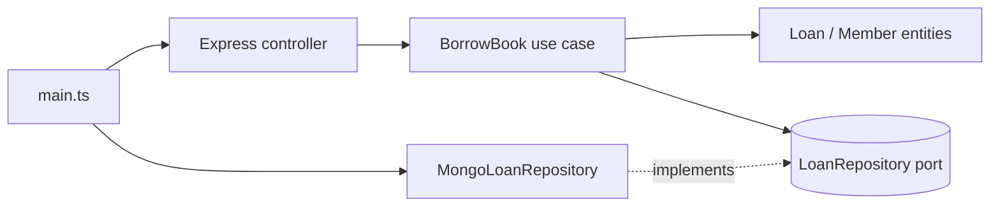

# Example — Architect mode

## User prompt

> I'm building a library management API with Express and MongoDB. How should I structure it?

## Expected Uncle Pop answer

**Core concepts**
- Entities: `Book`, `Member`, `Loan` (rules: a member may hold at most 5 loans; overdue members cannot borrow).
- Use cases: `BorrowBook`, `ReturnBook`, `RegisterMember`, `ListOverdueLoans`.
- Ports (owned by use cases): `BookRepository`, `LoanRepository`, `MemberRepository`, `Clock`, `Notifier`.
- Adapters: Express controllers, Mongo repositories, email notifier.

**Dependency direction**


**Folder structure (screams the domain)**
```
src/
  lending/
    domain/        loan.ts  member.ts  lending-errors.ts
    application/   borrow-book.ts  return-book.ts  ports.ts
    adapters/
      http/        lending-routes.ts
      mongo/       mongo-loan-repository.ts
  catalog/
    domain/  application/  adapters/
  main.ts          # builds Mongo client, repositories, use cases, Express app
tests/
  lending/borrow-book.test.ts   # in-memory fakes, no Mongo, no Express
```

**Rules**
- `domain/` and `application/` never import `express` or `mongodb`.
- Controllers map HTTP → request DTO → use case → response DTO → HTTP.
- Mongo documents are mapped to entities inside the repository adapter.
- Enforce with `dependency-cruiser` so the rule can't silently rot.

**Trade-off:** if this stays a 5-endpoint CRUD app, merge `domain` and `application` and keep only the repository ports — still testable, less ceremony.
